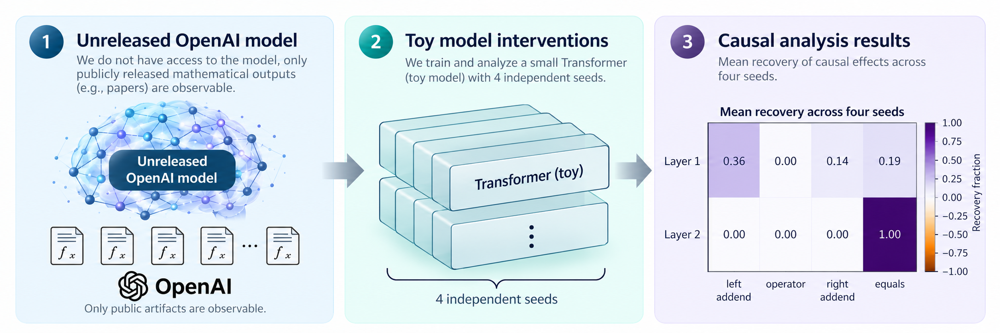
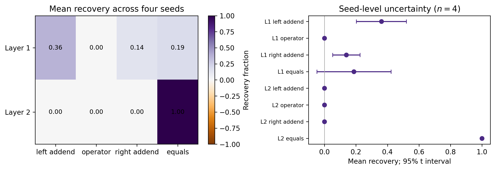

# OpenAI Mathematics Corpus Artifact Audit

  <strong>Reverse-Engineering Mathematical Reasoning from OpenAI's 2026 Mathematics Corpus: Implications for Mechanistic Interpretability</strong> 
  Taechasith Kangkhuntod 
  School of Engineering, University of the Thai Chamber of Commerce, Thailand

  <a href="paper/main.pdf">Read the paper</a> |
  <a href="release/arxiv_submission.zip">Download arXiv source</a> |
  <a href="reports/FINAL_AUDIT.md">Review final audit</a> |
  <a href="SIMULATION_PROTOCOL.md">Read simulation protocol</a> |
  <a href="https://github.com/taechasith/What-2026OpenAI-Hides">Project home</a>

> **Research-release status.** Reproducible public-artifact audit, frozen
> corpus provenance, four-seed causal surrogate simulation, verified
> nine-page manuscript, and independently compiled arXiv source archive.

## Executive summary

This repository studies the public, Apache-2.0-licensed
[openai/math](https://github.com/openai/math) release at immutable commit
<code>fd4aeeb2ee4fc729c18d98444fed42fd0529eeeb</code>. It now structurally
indexes **every versioned release blob**—133,955 files (2.06 GiB)—as well as
the preregistered catalogue-linked mathematics artifacts, Lean scope
documents, and ten explicitly released abridged reasoning summaries.

The public release does **not** contain model weights, activations, prompts,
or complete hidden reasoning. Accordingly, this repository makes no claim to
have reverse-engineered an OpenAI model. Its causal experiment is a separate,
executed four-seed residual-stream-patching simulation in fully inspectable
toy Transformers. It demonstrates a method, not an OpenAI-internal mechanism.

  

<em>Figure 1. Evidence boundary and causal-analysis workflow.</em>

## Study at a glance

| Public-artifact audit | Inspectable surrogate simulation |
| --- | --- |
| 133,955 Git-tree blobs structurally indexed | 4 independent initialization seeds |
| 372 result families | 2 layers, 3 heads, 39,264 parameters |
| 719 catalogue-linked manuscripts | 100 modulo-10 addition prompts per model |
| 122,876 Lean sources; 8,007 TeX sources | Exact in-table fit for every seed |
| 242 Lean scope documents | Seed-level uncertainty across four models |
| 10 released abridged summaries | Post-block residual-state patching |
| Mann-Whitney <i>p</i> = 0.638 | Left-addend recovery = 0.36, 95% t CI [0.20, 0.52] |

## What the evidence supports

| Claim | Status |
| --- | --- |
| Structure and coverage of every versioned `openai/math` release blob | Supported by the exhaustive, pinned Git-tree inventory. |
| Public artifact availability and catalogue structure | Supported by the pinned Git-tree audit. |
| Lean-document availability | Supported; not a claim of Lean compilation or mathematical correctness. |
| Properties of the released reasoning-summary text | Descriptive only; the summaries are selected and abridged. |
| Causal residual-state effects in the toy models | Supported by the released four-seed simulation records. |
| Neural mechanisms of OpenAI's unreleased model | Not supported and explicitly out of scope. |

The prespecified corpus estimands are documented in
[RESEARCH_PROTOCOL.md](RESEARCH_PROTOCOL.md) and
[PREREGISTRATION.md](PREREGISTRATION.md). The surrogate architecture,
interventions, controls, seeds, stopping rule, and uncertainty convention were
fixed in [SIMULATION_PROTOCOL.md](SIMULATION_PROTOCOL.md) before its execution.
The full release-tree census is a separately documented exploratory extension:
[FULL_TREE_INVENTORY_PROTOCOL.md](FULL_TREE_INVENTORY_PROTOCOL.md). It covers
every **versioned file in this mathematics repository**, not every research
artifact OpenAI has published through other channels.

## Results and release artifacts

| Artifact | Purpose |
| --- | --- |
| [paper/main.pdf](paper/main.pdf) | Publication-ready, nine-page manuscript with 31 cited sources. |
| [release/arxiv_submission.zip](release/arxiv_submission.zip) | Verified 14-file arXiv source bundle, including the overview, whole-tree figure, and registered protocols. |
| [reports/FINAL_AUDIT.md](reports/FINAL_AUDIT.md) | Evidence for builds, visual checks, archive validation, and claim boundaries. |
| [data/derived/corpus_manifest.json](data/derived/corpus_manifest.json) | Pinned corpus commit, source hashes, and Git-object validation record. |
| [data/derived/full_tree_summary.json](data/derived/full_tree_summary.json) | Counts, bytes, roles, extensions, and validation for all 133,955 release blobs. |
| [data/derived/full_tree_inventory.csv](data/derived/full_tree_inventory.csv) | One derived metadata row per versioned blob; no third-party file contents. |
| [data/derived/surrogate_patching_seed.csv](data/derived/surrogate_patching_seed.csv) | All site-by-seed causal-recovery estimates. |
| [data/derived/surrogate_patching_summary.csv](data/derived/surrogate_patching_summary.csv) | Means, sample standard deviations, and Student-t intervals across seeds. |
| [data/derived/surrogate_primary_contrast.json](data/derived/surrogate_primary_contrast.json) | Prespecified Layer-1 left-addend versus operator comparison. |

  

<em>Figure 2. Mean causal recovery and seed-level 95% Student-t intervals in the inspectable surrogate.</em>

## Reproduce

### Requirements

- Python 3.10+
- Git
- Tectonic, for the manuscript build

### End-to-end workflow

~~~powershell
python -m pip install -e .
git -c core.longpaths=true clone https://github.com/openai/math.git external/openai-math-full
git -C external/openai-math-full checkout --detach fd4aeeb2ee4fc729c18d98444fed42fd0529eeeb

python -m oai_math_study.run_analysis --corpus external/openai-math-full --root .
python -m oai_math_study.surrogate --root .
python -m pytest -q

tools\tectonic\tectonic.exe -X compile paper/main.tex --outdir paper --keep-logs --keep-intermediates
python scripts\build_release.py
~~~

On Windows, deeply nested upstream paths may exceed ordinary checkout limits.
The analysis reads verified immutable Git blobs directly, so those artifacts
are not silently omitted when working-tree materialization fails.

## Repository structure

| Path | Contents |
| --- | --- |
| <code>src/</code> | Corpus parser, full-tree inventory, statistics, figure generation, and multi-seed causal simulation. |
| <code>tests/</code> | Unit tests, including seed-level uncertainty validation. |
| <code>data/derived/</code> | Provenance manifest, exhaustive file metadata, public-artifact measurements, and simulation outputs. |
| <code>figures/</code> | Paper figures, including the supplied conceptual overview. |
| <code>paper/</code> | LaTeX source, bibliography, generated macros, and compiled manuscript. |
| <code>release/</code> | ArXiv-ready source archive. |
| <code>reports/</code> | Final audit and reproducibility evidence. |
| <code>external/</code> | Ignored third-party corpus clone; never redistributed. |

## Citation and license

Please cite the accompanying manuscript using [CITATION.cff](CITATION.cff).
Repository-authored code and documentation are licensed under
[Apache-2.0](LICENSE). The upstream corpus is not redistributed; its separate
license and provenance are preserved in
<code>data/derived/corpus_manifest.json</code>.
